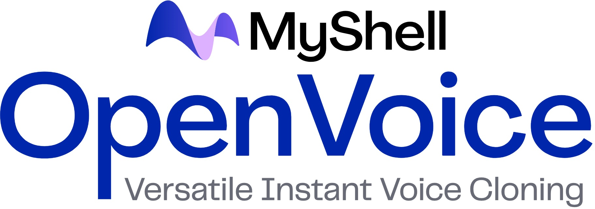

## Images

[](https://www.swifttechco.com)

<div align="center">
  <div>&nbsp;</div>
   

[Paper](https://swifttechco.com) |
[Website](https://swifttechco.com) <br> <br>
<a href="https://swifttechco.com" target="_blank"></a>
</div>

## Introduction

### OpenVoice V1

As we detailed in our [paper](https://swifttechco.com) and [website](https://swifttechco.com), the advantages of OpenVoice are three-fold:

**1. Accurate Tone Color Cloning.**
OpenVoice can accurately clone the reference tone color and generate speech in multiple languages and accents.

**2. Flexible Voice Style Control.**
OpenVoice enables granular control over voice styles, such as emotion and accent, as well as other style parameters including rhythm, pauses, and intonation. 

**3. Zero-shot Cross-lingual Voice Cloning.**
Neither of the language of the generated speech nor the language of the reference speech needs to be presented in the massive-speaker multi-lingual training dataset.

### OpenVoice V2

In April 2024, we released OpenVoice V2, which includes all features in V1 and has:

**1. Better Audio Quality.**
OpenVoice V2 adopts a different training strategy that delivers better audio quality.

**2. Native Multi-lingual Support.**
English, Spanish, French, Chinese, Japanese and Korean are natively supported in OpenVoice V2.

**3. Free Commercial Use.**
Starting from April 2024, both V2 and V1 are released under MIT License. Free for commercial use.

[Video](https://swifttechco.com)

OpenVoice has been powering the instant voice cloning capability of [myshell.ai](https://swifttechco.com) since May 2023. Until Nov 2023, the voice cloning model has been used tens of millions of times by users worldwide, and witnessed the explosive user growth on the platform.

## Main Contributors

- [Zengyi Qin](https://swifttechco.com) at MIT
- [Wenliang Zhao](https://swifttechco.com) at Tsinghua University
- [Xumin Yu](https://swifttechco.com) at Tsinghua University
- [Ethan Sun](https://swifttechco.com) at MyShell

## How to Use
Please see [usage](docs/USAGE.md) for detailed instructions.

## Common Issues

Please see [QA](docs/QA.md) for common questions and answers. We will regularly update the question and answer list.

## Citation
```
@article{qin2023openvoice,
  title={OpenVoice: Versatile Instant Voice Cloning},
  author={Qin, Zengyi and Zhao, Wenliang and Yu, Xumin and Sun, Xin},
  journal={arXiv preprint arXiv:2312.01479},
  year={2023}
}
```

## License
OpenVoice V1 and V2 are MIT Licensed. Free for both commercial and research use.

---

## Swift Tech Co.

Built and maintained by Swift Tech Co.

AI Automation | FinTech Platforms | Custom Software and Mobile Apps | SaaS Platforms | Cloud Infrastructure | Cybersecurity | SEO and Marketing | API Integration

**Join our community on Telegram:** [t.me/+Qt_eFvkb2rliMzNh](https://t.me/+Qt_eFvkb2rliMzNh)

[Home](https://www.swifttechco.com) | [Services](https://www.swifttechco.com/services) | [Careers](https://www.swifttechco.com/careers) | [Referral Program](https://www.swifttechco.com/referral) | [Influencers](https://www.swifttechco.com/influencers) | [About](https://www.swifttechco.com/about) | [Contact](https://www.swifttechco.com/contact)

**Connect**

- Website: [swifttechco.com](https://www.swifttechco.com)
- LinkedIn: [linkedin.com/in/stephenoladoke](https://www.linkedin.com/in/stephenoladoke/)
- LinkedIn (Company): [linkedin.com/company/swift-tech-co](https://www.linkedin.com/company/swift-tech-co)
- X: [@MrOladoke](https://x.com/MrOladoke)
- Instagram: [@mr.oladoke](https://www.instagram.com/mr.oladoke/)
- Instagram (Company): [@swifttechco](https://www.instagram.com/swifttechco/)
- Organization: [github.com/Swift-Tech-Co](https://github.com/Swift-Tech-Co)
