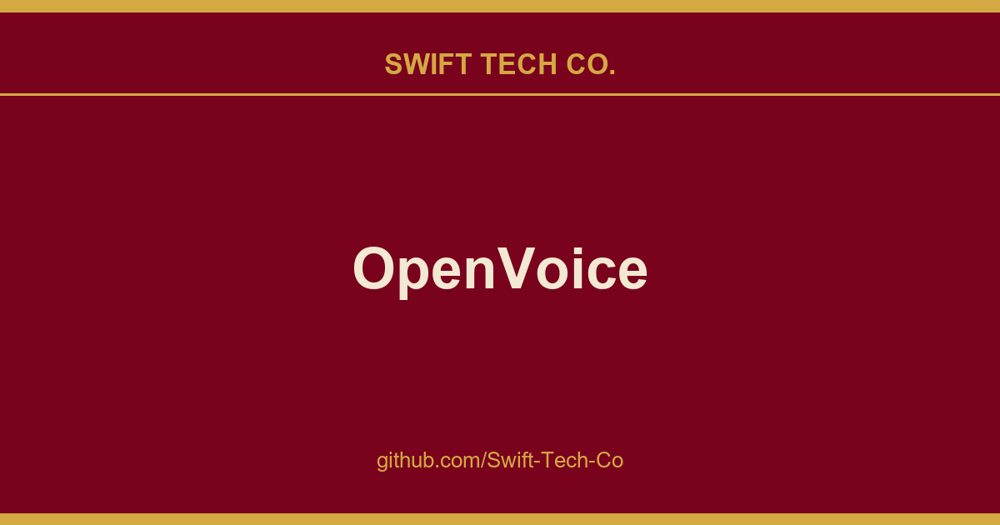

# OpenVoice

## What This Is

We keep a working index for product and engineering, and OpenVoice is the entry that collects our notes, examples and fixes. It reflects how Swift Tech Co. actually uses this in builds and client work.

## Images

[](https://github.com/Swift-Tech-Co/OpenVoice)

## Introduction

### OpenVoice V1

As we detailed in our paper and website, the advantages of OpenVoice are three-fold:

**1. Accurate Tone Color Cloning.**
OpenVoice can accurately clone the reference tone color and generate speech in multiple languages and accents.

**2. Flexible Voice Style Control.**
OpenVoice enables granular control over voice styles, such as emotion and accent, as well as other style parameters including rhythm, pauses, and intonation. 

**3. Zero-shot Cross-lingual Voice Cloning.**
Neither of the language of the generated speech nor the language of the reference speech needs to be presented in the massive-speaker multi-lingual training dataset.

### OpenVoice V2

In April 2024, we released OpenVoice V2, which includes all features in V1 and has:

**1. Better Audio Quality.**
OpenVoice V2 adopts a different training strategy that delivers better audio quality.

**2. Native Multi-lingual Support.**
English, Spanish, French, Chinese, Japanese and Korean are natively supported in OpenVoice V2.

**3. Free Commercial Use.**
Starting from April 2024, both V2 and V1 are released under MIT License. Free for commercial use.

Video

OpenVoice has been powering the instant voice cloning capability of myshell.ai since May 2023. Until Nov 2023, the voice cloning model has been used tens of millions of times by users worldwide, and witnessed the explosive user growth on the platform.

## Main Contributors

- Zengyi Qin at MIT
- Wenliang Zhao at Tsinghua University
- Xumin Yu at Tsinghua University
- Ethan Sun at MyShell

## How to Use
Please see [usage](docs/USAGE.md) for detailed instructions.

## Common Issues

Please see [QA](docs/QA.md) for common questions and answers. We will regularly update the question and answer list.

## Citation
```
@article{qin2023openvoice,
  title={OpenVoice: Versatile Instant Voice Cloning},
  author={Qin, Zengyi and Zhao, Wenliang and Yu, Xumin and Sun, Xin},
  journal={arXiv preprint arXiv:2312.01479},
  year={2023}
}
```

## License
OpenVoice V1 and V2 are MIT Licensed. Free for both commercial and research use.

---

## Swift Tech Co.

Built and maintained by Swift Tech Co.

AI Automation | FinTech Platforms | Custom Software and Mobile Apps | SaaS Platforms | Cloud Infrastructure | Cybersecurity | SEO and Marketing | API Integration

**Join our community on Telegram:** [t.me/+Qt_eFvkb2rliMzNh](https://t.me/+Qt_eFvkb2rliMzNh)

Home | Services | Careers | Referral Program | Influencers | About | Contact

**Connect**

- Website: https://github.com/Swift-Tech-Co/OpenVoice
- LinkedIn: [linkedin.com/in/stephenoladoke](https://www.linkedin.com/in/stephenoladoke/)
- LinkedIn (Company): [linkedin.com/company/swift-tech-co](https://www.linkedin.com/company/swift-tech-co)
- X: [@MrOladoke](https://x.com/MrOladoke)
- Instagram: [@mr.oladoke](https://www.instagram.com/mr.oladoke/)
- Instagram (Company): [@swifttechco](https://www.instagram.com/swifttechco/)
- Organization: [github.com/Swift-Tech-Co](https://github.com/Swift-Tech-Co)

## Sources

Compiled and maintained from upstream [myshell-ai/OpenVoice](https://github.com/myshell-ai/OpenVoice) under permissive open-source license.

---

Maintained by [Swift Tech Co.](https://github.com/Swift-Tech-Co) - [Telegram](https://t.me/+Qt_eFvkb2rliMzNh)

## Sources

Compiled and maintained from upstream [myshell-ai/OpenVoice](https://github.com/myshell-ai/OpenVoice) under permissive open-source license.

---

Maintained by [Swift Tech Co.](https://github.com/Swift-Tech-Co) - [Telegram](https://t.me/+Qt_eFvkb2rliMzNh)

## Sources

Compiled and maintained from upstream [myshell-ai/OpenVoice](https://github.com/myshell-ai/OpenVoice) under permissive open-source license.

---

Maintained by [Swift Tech Co.](https://github.com/Swift-Tech-Co) - [Telegram](https://t.me/+Qt_eFvkb2rliMzNh)